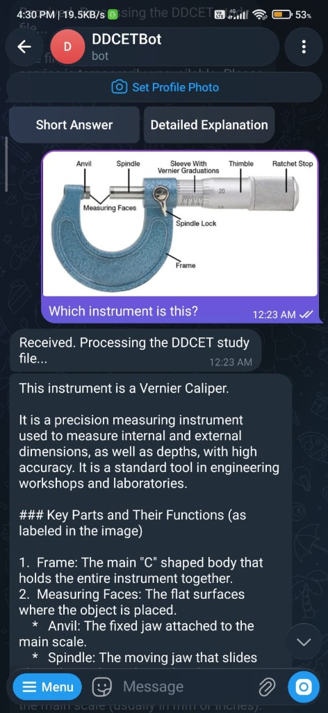
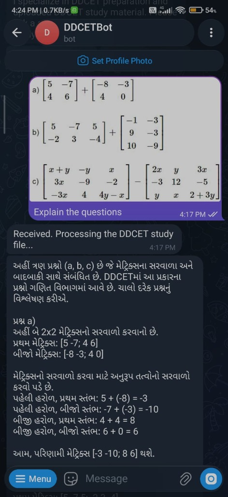
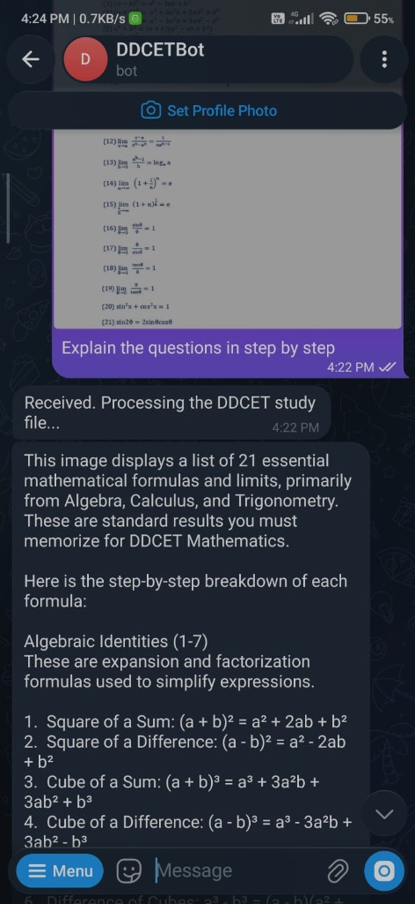

                                   🎓 DDCEThub — DDCET AI Study Assistant

<div align="center">


**An intelligent, multi-turn AI Study Assistant engineered for Gujarat Technological University (GTU) Diploma-to-Degree Common Entrance Test (DDCET) students.**

[System Architecture](#-system-architecture) • [Key Features](#-key-features) • [Tech Stack](#-technical-stack) • [Live Demo](#-live-demo--preview) • [Quickstart](#-getting-started)

</div>

---

## 📌 Executive Summary

Preparing for competitive engineering entrance exams requires instant clarification of complex STEM concepts, formula lookups, diagram parsing, and structured test preparation. 

**DDCEThub AI Assistant** is an asynchronous, domain-specialized study platform designed specifically for the **GTU DDCET examination** (covering BE-01 Science & Engineering and BE-02 Mathematics & Soft Skills). It combines **hybrid dense-sparse RAG retrieval**, **vision-based diagram understanding**, and **phone-optimized LaTeX-to-Unicode mathematical formatting** inside Telegram.

---

## 📸 Live Production Demos

<table>
  <tr>
    <td align="center" width="33%">
      
      <br />
      <b>🔬 Visual Diagram & Instrument OCR</b>
      <p><em>Identifies engineering instruments, labels key components, and explains working functions directly from student photos.</em></p>
    </td>
    <td align="center" width="33%">
      
      <br />
      <b>🌐 Multilingual Gujarati STEM Tutoring</b>
      <p><em>Solves complex 2x2 & 3x3 matrix arithmetic with step-by-step Gujarati regional explanation.</em></p>
    </td>
    <td align="center" width="33%">
      
      <br />
      <b>📐 Step-by-Step Formula & Limits Derivation</b>
      <p><em>Parses dense lists of calculus limits and algebraic identities with phone-friendly Unicode formatting.</em></p>
    </td>
  </tr>
</table>

---

## 🧠 System Architecture

The core pipeline decouples interface adapters from domain logic, vector storage, and model routing:

```
                      [ Telegram Client / Web API ]
                                   │
                                   ▼
                       ┌───────────────────────┐
                       │  Event Router         │
                       │  (Async Handler)      │
                       └───────────┬───────────┘
                                   │
              ┌────────────────────┴────────────────────┐
              ▼                                         ▼
   [ Text Query Pipeline ]                   [ Multimodal Pipeline ]
              │                                         │
              ▼                                         ▼
   ┌───────────────────────┐                 ┌───────────────────────┐
   │ Contextualize Query   │                 │ PDF / Image Ingestion │
   │ (Resolves follow-ups) │                 │ (Tesseract OCR / PIL) │
   └──────────┬────────────┘                 └──────────┬────────────┘
              │                                         │
              ▼                                         ▼
   ┌─────────────────────────────────────────────────────────┐
   │         Hybrid RAG Engine (rag.py)                      │
   │  • Dense Vector Search: sentence-transformers MiniLM    │
   │  • Lexical BM25 Matching: Tokenized Term Overlap        │
   │  • Dynamic Threshold Filtering (Score >= 0.65)          │
   └──────────────────────────┬──────────────────────────────┘
                              │
                              ▼
   ┌─────────────────────────────────────────────────────────┐
   │         Resilient LLM Orchestrator (llm.py)             │
   │  • Primary Model: OpenAI GPT-OSS-120B via Groq Cloud    │
   │  • Fallback Model: OpenAI GPT-OSS-20B                   │
   │  • Vision Model: Qwen 3.8-27B Vision                    │
   │  • Auto Retry with Exponential Backoff (429/500)        │
   └──────────────────────────┬──────────────────────────────┘
                              │
                              ▼
   ┌─────────────────────────────────────────────────────────┐
   │         Telegram Formatter (telegram_format.py)         │
   │  • LaTeX Math Equations ➔ Clean Phone Unicode           │
   │  • Matrix Environments ➔ Bracketed Rows                 │
   │  • Markdown Tables ➔ Readable Bullet Cards              │
   └──────────────────────────┬──────────────────────────────┘
                              │
                              ▼
                     [ Clean Telegram Output ]
```

---

## ✨ Key Technical Highlights

### 1. 🔍 Hybrid Dense-Sparse RAG (Retrieval-Augmented Generation)
* Combines **dense vector embeddings** (`sentence-transformers/all-MiniLM-L6-v2`) with **sparse lexical keyword scoring** to eliminate semantic hallucination.
* Grounds answers strictly within official GTU syllabi and past DDCET examination papers (2024 & 2025).
* Implements dynamic threshold gating to reject out-of-scope non-academic inputs gracefully without polluting responses.

### 2. ⚡ High-Throughput, Resilient LLM Orchestration
* Integrated with **Groq Cloud API** for ultra-low latency (<1.5s time-to-first-token).
* Automatic model failover from primary large parameter models to secondary lightweight models upon rate limits (`HTTP 429`) or server degradation (`HTTP 500`).
* System prompt architecture dynamically adapts to student profile language preferences (**English**, **Hinglish**, and **Gujarati**).

### 3. 📱 Mobile-First Mathematical Renderer
* Standard Telegram message viewers cannot render MathJax or KaTeX LaTeX tags (`\frac`, `\begin{bmatrix}`, `\sqrt`).
* Built a custom string transformation engine in `telegram_format.py` that translates complex matrices into phone-readable bracketed arrays, transforms superscripts/subscripts into native Unicode characters, and converts wide markdown tables into compact card lists.

### 4. 🖼️ Multimodal Vision & Diagram Solver
* Direct processing of student-uploaded textbook photos, handwritten formulas, and circuit/diagram screenshots.
* Multi-page PDF parsing with text layer extraction and fallback OCR for scanned question papers.

### 5. 📊 Interactive Quiz & Mistake Memory Engine
* Dynamic MCQ generator targeting specific DDCET syllabus units.
* Tracks student response histories, isolating repeat mistakes to construct targeted practice drills.

---

## 🛠️ Technical Stack

* **Language:** Python 3.11+
* **Framework:** `python-telegram-bot` (Asyncio polling & callback dispatcher)
* **LLM Engine:** Groq Cloud API (`openai/gpt-oss-120b`, `qwen/qwen3.8-27b vision`)
* **Vector Embeddings:** `sentence-transformers` (all-MiniLM-L6-v2)
* **Vision & OCR:** Pillow, PDFPlumber, PyTesseract OCR
* **Database:** SQLite3 with WAL (Write-Ahead Logging) mode enabled
* **Networking:** HTTPX (Async HTTP client with custom connection pooling)

---

## 📂 Repository Structure

```text
DDCET-AI-Assistant/
├── core/
│   ├── main.py              # Application lifecycle & dependency wiring
│   ├── llm.py               # Groq client, prompt engineering & model routing
│   ├── rag.py               # SentenceTransformer vector index & cosine similarity
│   ├── ddcet.py             # Query contextualization & source attribution
│   ├── db.py                # Database connection & persistence layer
│   ├── ddcet_handlers.py    # Telegram command, callback & message handlers
│   ├── media.py             # Image normalization & multi-page PDF processing
│   ├── telegram_format.py   # LaTeX-to-Unicode mathematical formatter
│   └── text_extraction.py   # PDF text extraction & OCR fallback pipeline
├── docs/
│   └── telegram_bot_demo.png# Screenshot showcasing real-world student interaction
├── .env.example             # Safe environment variable configuration template
├── .gitignore               # Strict exclude rules (no secrets, logs, or databases)
├── requirements.txt         # Production dependency definitions
└── README.md                # Project documentation
```

---

## 🚀 Getting Started

### 1. Clone the repository
```bash
git clone https://github.com/Jadav-Divyaraj/DDCET-AI-Assistant.git
cd DDCET-AI-Assistant
```

### 2. Configure Environment
Create a `.env` file based on `.env.example`:
```bash
cp .env.example .env
```
Fill in your credentials:
```ini
TELEGRAM_BOT_TOKEN="your_bot_token"
GROQ_API_KEY="your_groq_api_key"
GROQ_TEXT_MODELS="openai/gpt-oss-120b,openai/gpt-oss-20b"
GROQ_VISION_MODEL="qwen/qwen3.8-27b"
```

### 3. Install Dependencies
```bash
python -m venv .venv
source .venv/bin/activate  # On Windows: .venv\Scripts\activate
pip install -r requirements.txt
```

### 4. Run the Application
```bash
python -m core.main
```

---

## 👨‍💻 Engineer & Author

**Divyaraj Jadav**  
*Lead Developer & AI Engineer — DDCEThub Project*  
* Specialized in Full-Stack AI Integration, LLM Orchestration & RAG Architectures.

---

## 📄 License
This project is licensed under the MIT License - see the LICENSE file for details.
